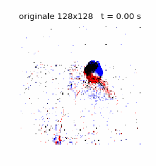
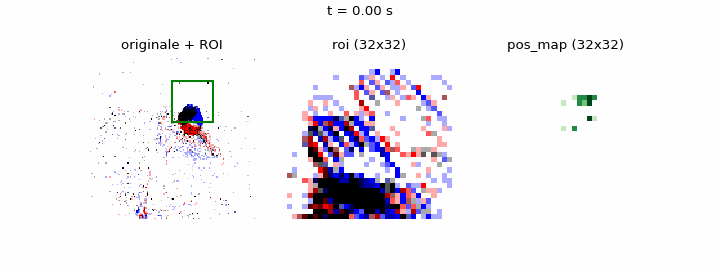

# DVSGesture ROI Challenge

Obiettivo: trovare la rete migliore per classificare gli 11 gesti di **DVSGesture**
(camera a eventi, sensore 128x128) usando una **regione di interesse (ROI)** che segue
il gesto e la sua **posizione** sul sensore. Come combinare le due informazioni
fa parte della challenge.

## Il dataset

Le registrazioni originali sono flussi di eventi di una camera a eventi 128x128: ogni
evento dice che un pixel ha cambiato luminosità in un certo istante, con una polarità
(aumento o diminuzione). Per ridurre i dati, di ogni registrazione si tiene solo una
**finestra 32x32 (la ROI)** che si sposta seguendo il gesto. Avete quindi due
informazioni separate:

- **che cosa succede dentro la ROI**: gli eventi della finestra 32x32;
- **dove si trova la ROI** nel frame originale 128x128, istante per istante.

Nessuna delle due da sola è il frame originale: sta a voi decidere come usarle e
come combinarle nella rete.

Una registrazione originale (gesto *left hand wave*, frame da 50 ms; rosso e blu sono
le due polarità):



La stessa registrazione come la ricevete voi: a sinistra l'originale con la ROI
(riquadro verde), al centro `roi`, cioè cosa succede dentro il riquadro, a destra
`pos_map`, cioè dove si trova il riquadro:



Per ogni registrazione avete:

| campo        | shape            | contenuto |
|--------------|------------------|-----------|
| `roi`        | `[T, 32, 32, 2]` | frame di eventi dentro la ROI; i 2 canali sono le due polarità, il valore è il numero di eventi del pixel in quel frame |
| `pos_map`    | `[T, 32, 32, 1]` | posizione della ROI come immagine: il frame 128x128 ridotto a 32x32, che si "accende" nei punti in cui si trovava il centro della ROI durante quel frame |
| `pos_events` | lista di N array | eventi di posizione grezzi (vedi sotto) |
| `y`          | intero           | classe del gesto, 0..10 (vedi `data.CLASS_NAMES`) |

`roi` e `pos_map` sono già allineati: il frame `k` di entrambi copre lo stesso
intervallo di tempo.

### Eventi di posizione grezzi (`pos_events`)

Per chi vuole costruire una rappresentazione della posizione diversa da `pos_map`
(coordinate, traiettorie, velocità, ...). Ogni registrazione è un array strutturato
numpy con un evento ogni 1 ms:

| campo | significato |
|-------|-------------|
| `t`   | istante in microsecondi dall'inizio della registrazione |
| `x`, `y` | centro della ROI nel frame originale 128x128, in pixel (0..127): la ROI copre circa i pixel da `x - 16` a `x + 15` e da `y - 16` a `y + 15`, e può uscire in parte dal bordo del sensore |
| `s`   | dimensione della ROI: 32. Vale 1 solo nei primissimi eventi di alcune registrazioni (con `x = y = 16`), quando la ROI non è ancora stata individuata: questi eventi vanno ignorati |
| `p`   | sempre `False`, non contiene informazione |

Se usate `pos_events`, l'allineamento con i frame di `roi` è a vostro carico: i frame
partono dal primo evento della registrazione; nel test durano 200 ms e ne vengono
tenuti 7, nel train la registrazione, dal primo all'ultimo evento, è divisa in 64
intervalli uguali.

## Protocollo (fwdPass)

Ogni registrazione è una sequenza di `T` frame. La rete classifica **un frame alla volta**
e la predizione sulla registrazione è la media delle probabilità dei suoi frame
(soft majority vote).

- **train**: ogni registrazione è divisa in `T = 64` frame di uguale durata
- **test**: frame di durata fissa `delta_t = 200 ms`; si tengono i primi 7
  (registrazioni più corte di 1.5 s vengono scartate) → `T = 7` frame

Per avere risultati confrontabili **non cambiate la metrica né i frame del test**:
usate `data.load_split("test")` con i parametri di default e `evaluate.accuracy`.
L'unica eccezione è caricare il test con frame più corti e raggrupparli negli stessi
7 frame da 200 ms (vedi gli esempi 3 e 4 sotto): la rete deve comunque dare una
predizione per ciascuno dei 7 frame.
Sul train invece potete fare quello che volete (augmentation, framing diverso con
`framing="delta_t"` o un altro `frames`, normalizzazioni, ...).

## Regole sulla rete

- Solo layer **convolutivi** (Conv1D / Conv2D) e **fully connected** (Dense). Sono
  ammessi i layer di supporto: pooling, batch normalization, dropout, flatten e
  concatenazione. **Niente RNN** (LSTM, GRU, ...) **né transformer / attention.**
- Funzioni di attivazione: solo **ReLU** ed **ELU** (più la softmax finale per avere
  le probabilità delle classi).
- **Meno di 300k parametri** in totale (tutti i rami della rete inclusi).

## Esempi di combinazione ROI + posizione

Sono le varianti provate da noi con il Symbolic DNN-Tuner. Servono come spunto: potete
migliorarle o inventarne altre.

**1. Mappa di posizione come canale in più** (`roigesture_matrix`).
`pos_map` viene concatenata a `roi` lungo i canali: un solo ingresso `[32, 32, 3]`
per frame, elaborato da una CNN 2D.

```python
x = np.concatenate([d["roi"], d["pos_map"]], axis=-1)   # [N, T, 32, 32, 3]
```

**2. Coordinate come secondo ingresso** (`roigesture_coords`).
Per ogni frame si calcola il centro di massa `(y, x)` di `pos_map` (2 numeri). La CNN
2D lavora solo su `roi`; le sue feature (dopo il flatten) vengono concatenate alle
2 coordinate e passate ai layer fully connected.

```
roi [32,32,2] -> Conv2D ... -> Flatten --\
                                          Concatenate -> Dense ... -> softmax
pos (y, x)  [2] -------------------------/
```

**3. Traiettoria della ROI con Conv1D** (`roigesture_conv1d`).
Ogni frame da 200 ms viene diviso in `K = 8` sotto-finestre da 25 ms. La CNN 2D riceve
`roi` sommata sulle 8 sotto-finestre (`[32, 32, 2]`); il secondo ingresso è la
traiettoria della ROI nel frame, cioè le coordinate `(y, x)` di ogni sotto-finestra
normalizzate in [0, 1] (`[8, 2]`; se una sotto-finestra non ha eventi di posizione si
ripete l'ultima posizione valida). La traiettoria passa da un piccolo ramo Conv1D, poi
le feature dei due rami vengono concatenate prima dei layer fully connected.

**4. Sotto-finestre come canali** (`roigesture_channels`).
Come nel 3, ogni frame è diviso in `K = 8` sotto-finestre, ma tutto finisce in un solo
ingresso `[32, 32, 2K + 1] = [32, 32, 17]`: le 8 `roi` delle sotto-finestre (2
polarità ciascuna) più la `pos_map` sommata sul frame come ultimo canale.

Per 3 e 4 le sotto-finestre si ottengono caricando i dati con frame da 25 ms e
raggruppandoli a 8 a 8 (vale anche per il test: 7 gruppi da 8 = gli stessi 7 frame da
200 ms):

```python
K = 8
d = data.load_split("test", framing="delta_t", delta_t=200_000 // K)   # T = 60 frame da 25 ms
roi_sub = d["roi"][:, :7 * K].reshape(-1, 7, K, 32, 32, 2)             # [N, 7, 8, 32, 32, 2]
map_sub = d["pos_map"][:, :7 * K].reshape(-1, 7, K, 32, 32, 1)         # [N, 7, 8, 32, 32, 1]
```

## Setup

```bash
pip install -r requirements.txt
```

Serve la cartella `DVSGestureROI_fs32/` (con `train/` e `test/`) dentro
`./rois_and_coordinates/datasets`, oppure passate il percorso con `root=`.
La prima volta la conversione in frame richiede alcuni minuti; poi gli array sono
salvati in `./cache/challenge/*.npz` e ricaricati subito.

Il framework per la rete è libero (PyTorch, TensorFlow, ...): `data.py` e
`evaluate.py` usano solo numpy e tonic.

## Uso

```python
import data, evaluate

train, test = data.load_dataset()
train["roi"].shape       # (N, 64, 32, 32, 2)
train["pos_map"].shape   # (N, 64, 32, 32, 1)
train["pos_events"][0]   # eventi di posizione della prima registrazione
train["y"].shape         # (N,)

# validation: split per registrazione (mai frame della stessa registrazione in train e val)
tr, va = data.train_val_split(train)

# ... la vostra rete ...

# valutazione: probabilità per frame [N, T, 11] sulle registrazioni di test,
# nello stesso ordine di data.load_split("test")
acc = evaluate.accuracy(frame_probs, test["y"])
```

## Cosa consegnare

Il codice della rete (incluso come combinate ROI e posizione), l'accuracy sul test
ottenuta con `evaluate.accuracy` e il numero di parametri del modello.

## File

- `data.py` – caricamento del dataset (stesso preprocessing del Symbolic DNN-Tuner)
- `evaluate.py` – metrica ufficiale
- `img/` – le animazioni di questo README
